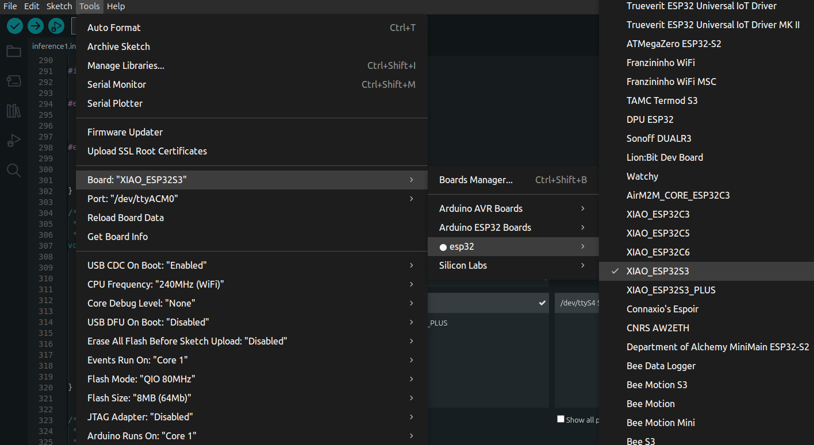
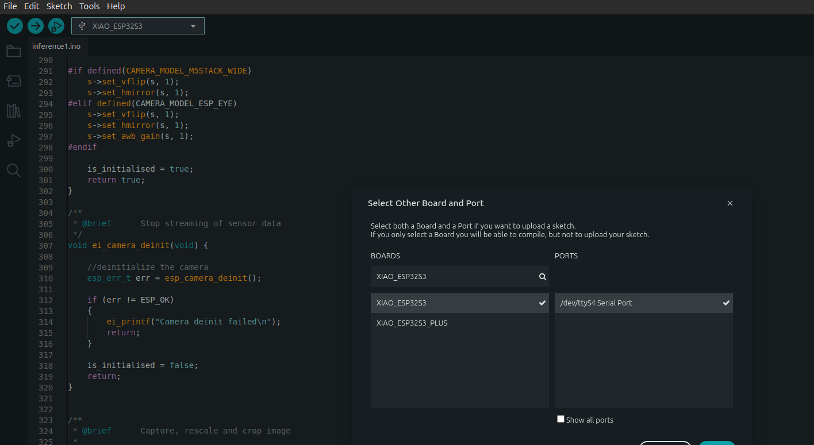
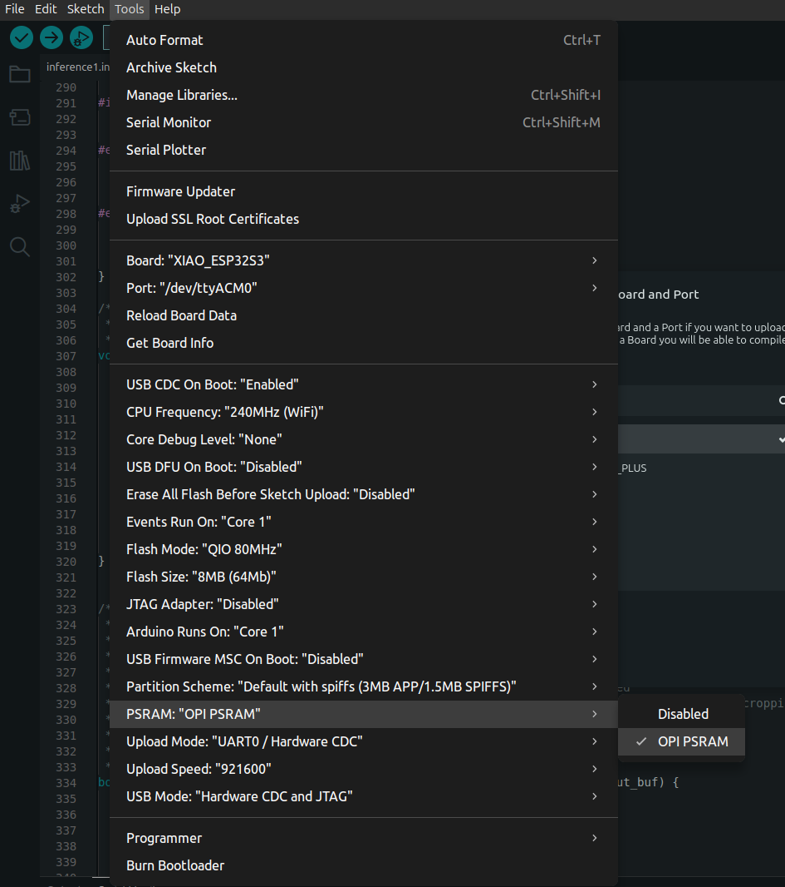
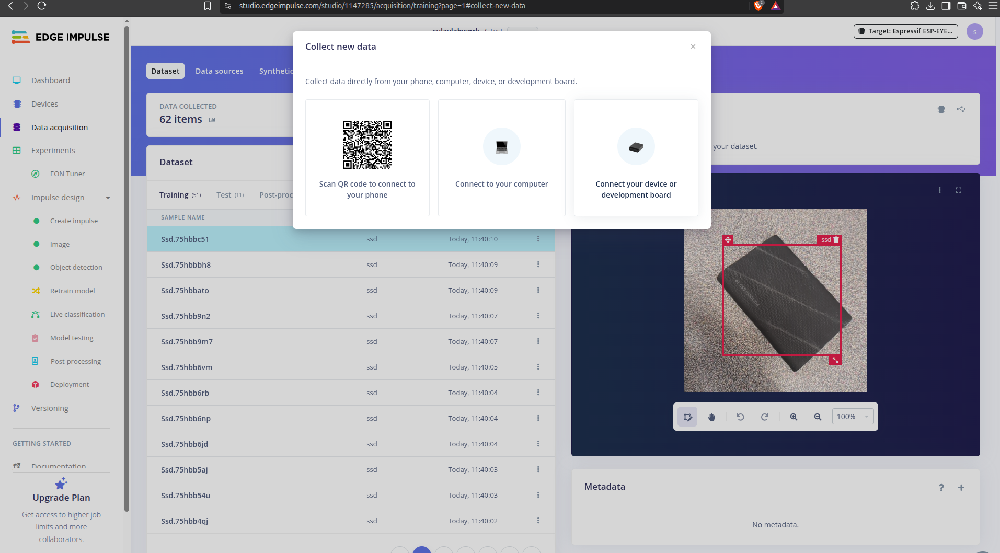
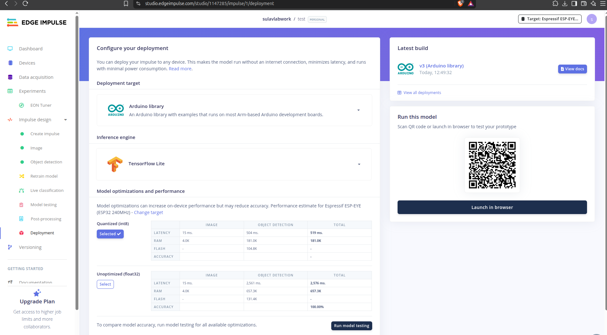

# Lab 3: On-Device AI Deployment on XIAO ESP32-S3

**ECE 4930/6930 – Artificial Intelligence of Things**

> [!NOTE]
> **Platform:** Seeed Studio XIAO ESP32S3 Sense  
> **Software:** SenseCraft AI (Task A) and Edge Impulse + Arduino IDE (Task B)
> **Format:** Team-based; one lab session with advance preparation for Task B
> **Preparation:** Before class, select a custom application and prepare its training data for Task B. Install Arduino IDE and the compatible ESP32 board package. If possible, train and export your model library in advance.

---

## Learning Objectives

By the end of this laboratory, you will be able to:

- Describe the role of a microcontroller in an AIoT system.
- Identify the sensing, memory, and computing resources of the XIAO ESP32S3 Sense.
- Deploy both a pretrained and a custom lightweight AI model on the physical XIAO board.
- Explain the steps from sensor input to on-device prediction.
- Test model behavior using real inputs and document representative results.
- Distinguish model-testing metrics, deployment estimates, and actual on-device measurements.
- Discuss tradeoffs among model capability, latency, memory, and power-constrained deployment.

---

## Background

In Labs 1–2, you used the NVIDIA Jetson Nano for edge AI inference. In Lab 3, you will use the **XIAO ESP32S3 Sense**, a much smaller microcontroller with a camera and microphone.

Unlike the Jetson, the XIAO does not run a full desktop Linux environment. Its computing and memory resources are much more limited, so models must be compact enough to deploy and execute locally.

A simplified TinyML/AIoT pipeline is:

```text
Physical Environment
        |
        v
Camera / Microphone
        |
        v
XIAO ESP32S3 Microcontroller
        |
        v
On-Device AI Inference
        |
        v
Prediction / Application Action
```

The objective is **not** to master every detail of microcontroller programming. Instead, you will complete **two required activities**: first verify a pretrained AI model on the physical board, then deploy and test your team's custom model.

### Both Tasks Are Required

- **Task A – Baseline Deployment.** Deploy an existing SenseCraft gesture model. No model training is required.
- **Task B – Custom Deployment.** Define a small task, train a lightweight model in Edge Impulse, and deploy it with Arduino IDE.

**Complete Task A first, then Task B.** Save your Task A results and demonstration evidence before uploading Task B to the same board, because programming a different model may replace the previous firmware. Follow this order in the numbered instructions:

``` text
Parts 1–2: Hardware and setup
        ↓
Task A: Part 3A → Part 4A → Task A trials in Part 5
        ↓
Task B: Part 3B → Part 4B → Task B trials in Part 5
        ↓
Part 6: Team reflection and report
```

Task B is open-ended: your team selects the application. Image classification is the fully described camera workflow; object detection or audio applications may require different code and additional adaptation. 

The class demonstration video uses **human-versus-dog image classification** to show the Edge Impulse-to-Arduino deployment workflow. It is an **example of the procedure, not a required or recommended project topic**. Human presence recognition (person versus no person) is another possible application, but your team may choose its own task.

> [!IMPORTANT]
> Task B is required. **Before lab**, choose your application, prepare labeled training and testing data, and watch the class demonstration video. Whenever possible, finish Edge Impulse training and download your Arduino library ahead of time. 

---

## Equipment

Each team should have:

- Seeed Studio XIAO ESP32S3 Sense board with its Sense expansion board;
- camera module attached to the Sense expansion board (for camera projects);
- USB-C **data** cable;
- laptop or desktop computer with internet access;
- SenseCraft AI access (Path A), or Edge Impulse account and Arduino IDE (Path B);
- test objects, images, gestures, or audio samples appropriate to the selected application.

A microSD card is **not required** for the guided image-classification workflow when training images are uploaded from a computer.

Students may work with individual XIAO boards if available. Collaborate on the custom application and submit one combined report per team covering both tasks; no formal operator/guide/recorder roles are assigned.

---

# Part 1 – Hardware Overview

Identify the following components and their roles:

| Component | Function in the AIoT System |
|---|---|
| XIAO ESP32S3 | Runs the microcontroller program and AI inference locally |
| Camera | Captures image input, when used |
| Microphone | Captures audio input, when used |
| Flash memory | Stores firmware and model data |
| PSRAM | Provides additional memory for camera buffers and inference |
| USB-C connection | Supplies power and supports programming/communication |


The XIAO ESP32-S3 has significantly less memory and compute capacity than the Jetson Nano.

Consider how that difference might influence model selection.

---

# Part 2 – Connect and Prepare the Board

1. Connect the XIAO Sense expansion board and camera securely, if your application uses the camera.
2. Connect the XIAO to a computer using a USB **data** cable.
3. Follow only the setup instructions needed for your selected path.

## Task A – SenseCraft Setup

Path A uses SenseCraft's supported browser-based deployment workflow.

**Arduino IDE and Edge Impulse are not required** for this task.

Open [SenseCraft AI](https://sensecraft.seeed.cc/ai/) and follow its XIAO ESP32S3 Sense device-connection workflow.

If the browser requests serial-port permission, select the port corresponding to your XIAO.

## Task B – Arduino Setup

Open Arduino IDE.

In **Boards Manager**, install **esp32 by Espressif Systems**, if needed.

For the camera sketch used in the Seeed image-classification tutorial, the documented compatible Arduino-ESP32 board package is **version 2.x**; version 3.x may require code changes.

Select:

| Setting | Value |
|---|---|
| Board | `XIAO_ESP32S3` |
| Port | The connected XIAO USB port |
| PSRAM | `OPI PSRAM` |
| USB CDC On Boot | Enabled, if available |
| Serial Monitor | `115200` baud |





For a basic programming check:

1. Open **File → Examples → 01.Basics → Blink**.
2. Click **Verify**.
3. Click **Upload**.
4. Confirm the sketch uploads successfully.

Blink does not need to print to Serial Monitor.

> [!NOTE]
> The exact Tools menu can differ by Arduino board-package version. Use the XIAO board, select its actual port, and ensure PSRAM is enabled for camera inference.

---

# Part 3 – Prepare the AI Model

## Part 3A – Task A: Pretrained Gesture Model

1. Open the [SenseCraft gesture-detection example](https://sensecraft.seeed.cc/ai/view-model/60111-gesture-detection?tab=public), or another gesture model explicitly marked as compatible with **XIAO ESP32S3 Sense**.
2. Identify the model's name, source link, and gesture labels.
3. Review the model's supported deployment instructions.
4. Skip Edge Impulse data collection, training, and Arduino camera-code changes.

If the linked example is unavailable, use the [SenseCraft XIAO model guide](https://sensecraft.seeed.cc/wiki/en/sensecraft-ai/guides/models/using-a-model/sensecraft-ai-pretrained-models-for-xiao/) to find a compatible gesture model.

**Submission:** Identify the pretrained model and the gestures it is designed to recognize.

---

## Part 3B – Task B: Team-Selected Custom Model

### Step 1 – Define the Application

Choose a small AI task that can be tested with the available XIAO camera or microphone.

Define:

- What input will be captured?
- What prediction should the model produce?
- How will the team test the prediction on the physical board?

For a camera-based image classifier, choose a small set of clearly distinguishable labels, often two classes.

The team may adapt an existing idea or design its own application.

### Step 2 – Prepare Data

1. Create a project at [Edge Impulse](https://studio.edgeimpulse.com/).
2. Under **Data acquisition**, upload or collect labeled samples.
3. Make sure each class has representative examples with variation in background, viewpoint, or environment.
4. Keep **training and testing data separate**; do not evaluate using exact duplicates of training samples

For a simple image classifier, approximately **20–30 training images per class** plus separate test images can be a starting point, **not a guaranteed accuracy target or strict minimum**.

More diverse, well-labeled data are generally preferable.




### Step 3 – Design and Train

Under **Impulse design**, choose processing and learning blocks suitable for your application.

For the camera image-classification workflow shown in the class video:

1. Use an **Image** input and a small supported resolution, for example, `96 × 96`.
2. Add an **Image** processing block.
3. Add a small **Transfer Learning (Images)** classification model.
4. Generate features and train the model.

For object detection or audio, select the appropriate task-specific blocks and follow a compatible deployment example.

The `esp32_camera` modifications in Part 4B apply **only to camera projects using that example sketch**.

### Step 4 – Evaluate in Edge Impulse

Use **Model testing** with held-out examples.

Observe:

- the reported test accuracy for classification, or a task-appropriate testing metric for another model;
- at least one example prediction;
- cases where the model makes incorrect or uncertain predictions, if observed.

Remember that Edge Impulse testing measures model behavior on the test data; it does **not** prove the model is already running on the XIAO.

### Step 5 – Prepare the Deployment Library

Open **Deployment** in Edge Impulse.

Select:

| Setting | Selection |
|---|---|
| Deployment target | Arduino library |
| Inference engine | TensorFlow Lite, if available |
| Optimization | Quantized (INT8), if supported |

Build and download the generated `.zip` library.

Record estimated inference latency, Flash/ROM, and RAM **if available**, along with the device used for the estimate.

For example, an **ESP-EYE estimate is not a measurement on the XIAO**.

**Submission:** Record the custom task, model/classes, training/test information, test metric, example prediction, and any available deployment estimates.

---

# Part 4 – Deploy the Model to the XIAO

## Part 4A – Task A: SenseCraft Deployment

1. Open the selected compatible gesture model in SenseCraft.
2. Choose **Deploy Model** and follow the supported XIAO device-connection prompts.
3. Select the correct serial port and complete the model upload.
4. Open the supported live preview or output view.
5. Confirm that the physical XIAO camera is providing input and that model predictions appear.

If a model is not supported on the XIAO, choose another compatible gesture model rather than changing Arduino code.

**Submission:** Save evidence of successful on-device gesture recognition.

---

## Part 4B – Task B: Edge Impulse + Arduino Deployment

### Step 1 – Import the Arduino Library

1. In Arduino IDE, choose **Sketch → Include Library → Add .ZIP Library**.
2. Import the `.zip` library downloaded from Edge Impulse.
3. Open **File → Examples → [your Edge Impulse library]**.
4. For the guided camera workflow, open the **`esp32_camera`** example, if provided. For other tasks, select the appropriate example or compatible application sketch.

Keep the generated model include, such as:

```cpp
#include <my_project_inferencing.h>
```

unchanged.

Any camera-pin changes are made in the **example sketch**, not in the generated model header.



### Step 2 – Adjust Camera Pins (Camera Example Only)

The `esp32_camera` example may use **ESP-EYE** camera pins, which are different from the XIAO pins.

**Only apply the following edits if your sketch matches the ESP-EYE-style example shown in the class video.**

If your sketch already has XIAO camera definitions, do not replace them a second time.

#### Edit A – Replace the ESP-EYE GPIO Values

Find the:

```cpp
#if defined(CAMERA_MODEL_ESP_EYE)
```

section.

Within that section, replace the old camera pin definitions (`PWDN_GPIO_NUM` through `PCLK_GPIO_NUM`) with:

```cpp
#define PWDN_GPIO_NUM   -1
#define RESET_GPIO_NUM  -1
#define XCLK_GPIO_NUM   10
#define SIOD_GPIO_NUM   40
#define SIOC_GPIO_NUM   39
#define Y9_GPIO_NUM     48
#define Y8_GPIO_NUM     11
#define Y7_GPIO_NUM     12
#define Y6_GPIO_NUM     14
#define Y5_GPIO_NUM     16
#define Y4_GPIO_NUM     18
#define Y3_GPIO_NUM     17
#define Y2_GPIO_NUM     15
#define VSYNC_GPIO_NUM  38
#define HREF_GPIO_NUM   47
#define PCLK_GPIO_NUM   13
```

Keep the existing:

```cpp
#define CAMERA_MODEL_ESP_EYE
```

and:

```cpp
#if defined(CAMERA_MODEL_ESP_EYE)
```

statements for **this specific sketch**.

You are replacing the pin values inside the selected branch.

Do not delete nearby `#elif`, `#else`, or `#endif` lines.

#### Edit B – Remove ESP-EYE-Only Pin Settings

Find:

```cpp
ei_camera_init()
```

Remove the following block **only if it appears**:

```cpp
#if defined(CAMERA_MODEL_ESP_EYE)
  pinMode(13, INPUT_PULLUP);
  pinMode(14, INPUT_PULLUP);
#endif
```

GPIO 13 and GPIO 14 are camera signals on the XIAO.

Leave the rest of `ei_camera_init()` unchanged.

> [!NOTE]
> Audio applications do **not** use the camera GPIO edits above. They require a compatible microphone-input example.
>
> Other versions of the Edge Impulse Arduino examples may require different adaptations.

### Step 3 – Verify, Upload, and Observe

1. Confirm the board, port, and **OPI PSRAM** settings.
2. Click **Verify**, then **Upload**.
3. Open **Serial Monitor** at `115200` baud.
4. Present input appropriate to your model, such as an object, a printed image, an image on a screen, or a sound.
5. Observe class labels, confidence scores, and inference timing, when displayed.

A successful Edge Impulse browser test is **not** sufficient by itself.

The goal is inference on the **physical XIAO**.

**Submission:** Include upload/deployment evidence and a screenshot or short video showing actual on-device inference.

---

# Part 5 – Demonstration and Performance Evaluation

Test the model under more than one input condition.

## Task A – Gesture Recognition

Perform **five gesture trials**.

For each trial:

1. Present a gesture to the XIAO camera.
2. Identify the intended gesture.
3. Observe the gesture reported by the deployed model.
4. Record whether the prediction matches the intended gesture.

Include at least two different gesture types when possible.

## Task B – Custom Model

Run several representative live tests of your selected application.

For image classification:

- Test different classes.
- Vary lighting, distance, or background when possible.
- Observe how predictions or confidence scores change.
- Document one unexpected or incorrect result, if observed.

Compare these live observations with the results from Edge Impulse **Model testing**.

An individual confidence score is **not** the same as a test-set accuracy value.

## Performance and Evidence

For the selected path, collect the information available from your software and physical board:

- **Testing result:** Gesture-trial outcomes for Path A; held-out model test metric and an example prediction for Path B.
- **On-device inference timing:** Three readings and their median **if the running application reports timing**.
- **Model memory:** Flash/ROM and RAM estimates separately, **if available**.
- **Evidence:** One screenshot or short video clearly showing a prediction from the physical board. For Path B, also document successful Arduino upload.
- **Model source:** SenseCraft model link or Edge Impulse project/model name and any adapted example.

Label estimates clearly.

If a metric is unavailable, enter `N/A` rather than guessing.

**Submission:** Complete the demonstration and performance sections of the Lab 3 Submission Report.

---

# Part 6 – AIoT Reflection

Discuss the following questions with your team, considering both Task A and Task B:

1. Where does sensing occur, and where does AI inference run?
2. How is deploying a model on the XIAO different from running it on the Jetson Nano?
3. Which constraints matter most for your custom application: memory, computation, power, latency, or prediction reliability?
4. How did deploying a pretrained baseline differ from deploying your custom model? What was less obvious before testing on the hardware?
5. What improvement would you make if you continued developing this AIoT application?

Consider the complete system:

```text
Physical Environment
        |
        v
Camera / Microphone
        |
        v
XIAO ESP32S3 + AI Model
        |
        v
Local Prediction
        |
        v
Decision / Communication
```
---

## Troubleshooting – Only If Needed

| Symptom | First Check |
|---|---|
| Board not visible or upload fails | Use a USB data cable; confirm board and port. |
| No Serial Monitor text | Use `115200` baud and enable USB CDC On Boot if available; try Reset. |
| Camera initialization fails | Check the Sense camera connection and XIAO GPIO definitions. |
| Snapshot buffer allocation fails | Confirm `OPI PSRAM` is enabled; use a smaller model/input if necessary. |
| Tensor allocation/inference fails | Confirm the correct quantized library and PSRAM setting; consider a smaller model. |
| Model header not found | Re-import the correct Edge Impulse `.zip` library and use its generated example. |
| SenseCraft model cannot deploy | Confirm that the selected model explicitly supports XIAO ESP32S3 Sense. |

Avoid reinstalling or upgrading the entire toolchain during the lab unless instructed.

For a persistent issue, document the error and ask the instructor for help.

---

## Optional Advanced Challenge

If your team finishes early, investigate **one** extension:

- Test additional lighting, distances, backgrounds, or gesture conditions.
- Compare an INT8 model with another supported deployment configuration.
- Explore a smaller model or different input resolution.
- Investigate the effect of model choice on latency or memory.
- Connect the on-device prediction to an application action or communication step.

These extensions are optional and are **not required** for successful completion of Lab 3.

---

## Useful Resources

- [SenseCraft AI – Model Repository](https://sensecraft.seeed.cc/ai/)
- [SenseCraft – Using a Model with XIAO ESP32S3 Sense](https://sensecraft.seeed.cc/wiki/en/sensecraft-ai/guides/models/using-a-model/sensecraft-ai-pretrained-models-for-xiao/)
- [Edge Impulse Studio](https://studio.edgeimpulse.com/)
- [Seeed Studio – XIAO ESP32S3 Getting Started](https://wiki.seeedstudio.com/xiao_esp32s3_getting_started/)
- [Seeed Studio – XIAO Image-Classification Tutorial](https://wiki.seeedstudio.com/tinyml_course_Image_classification_project/)
- **Class demonstration video:** See the video posted on Canvas.

---

## After the Experiments

Complete the Lab 3 Submission Report and submit one report per team. Both Task A and Task B are required; document results and evidence for each task, followed by one shared reflection. Written analysis may be completed after the lab session.
